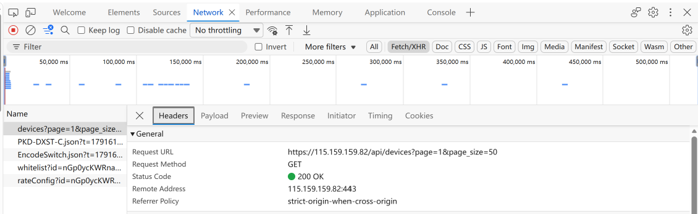
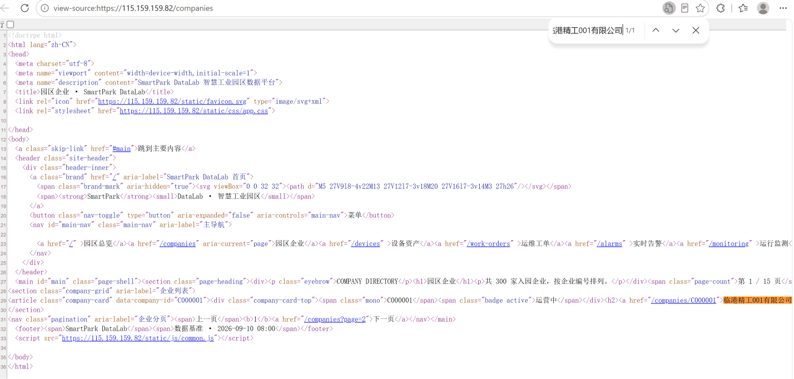
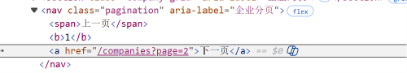
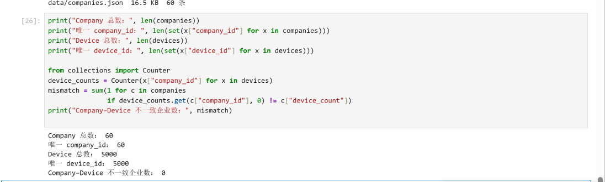

# Lab 1 实验报告

## 学生信息

- **姓名：王莫凡**
- **学号：112411090213**
- **班级：数据1241**
- **GitHub 用户名：**`wangMoFan1124yan`
- **仓库地址：**`https://github.com/wangMoFan1124yan/bigdata-collection-labs-112411090213`

> 文件位置：`lab01/REPORT.md`  
> 完整代码保存在 `lab1_html_api.ipynb`。  
> 本报告只填写关键发现、关键代码、结果和指定截图，**不要把整份 Notebook 复制进来**。

---

# 任务 1：判断数据加载方式

## 1.1 Device：判断动态加载并找到 API

### 判断结果

- 页面：`/devices`
- 数据加载方式：`动态加载`
- 判断依据：

在 `/devices` 页面使用“右键 → 查看网页源代码”，按 `Ctrl + F` 搜索页面上显示的设备名称（如 `循环泵-000001-001`）和编号 `D00000001`，**都搜索不到**；整个初始 HTML 只有约 3.5 KB，表格位置只有一个“正在读取设备数据…”的占位符。说明数据不是随 HTML 一起返回的。

打开 F12 → Network → 勾选 Fetch/XHR 并刷新页面后，抓到一条返回设备数据的请求 `GET /api/devices?page=1&page_size=50`，返回 `application/json`，其中 `items` 是设备列表、`total` 为 5000。设备数据是页面加载后由 JS 通过这个接口取回再渲染的，因此属于动态加载。

### API 信息

- Request URL：`https://115.159.159.82/api/devices?page=1&page_size=50`
- Request Method：`GET`
- Query 参数：`page=1`（页码，从 1 开始）、`page_size=50`（每页条数，前端固定传 50）

> 补充：`total` 是响应体里的字段，不是 Query 参数。该接口不需要 Cookie 或 Token，可直接用 `requests` 复现。
> 页面筛选框对应的可选参数为 `company_id`、`device_type`、`status`、`zone`；未填写时前端会把空值参数丢弃，所以请求中不出现。

### 【截图 1】Device API 发现证据

文件名：

```text
images/01_device_api.png
```

**截图内容必须是浏览器 DevTools，不是 Jupyter 代码。**

截图中应能看清：

1. 浏览器的 **Network** 面板；
2. 已选中真正返回设备列表的 Fetch/XHR 请求；
3. 右侧 **Headers** 中的 Request URL；
4. Query String Parameters（或 URL 中的分页参数）。

> 不要截整个桌面；尽量裁剪到 Network 请求和右侧 Headers 区域。

插入：

```markdown

```

---

## 1.2 Company：判断静态加载

- 页面：`/companies`
- 数据加载方式：`静态加载`
- 判断依据：

在 `/companies` 页面使用“右键 → 查看网页源代码”，按 `Ctrl + F` 搜索页面上真实显示的企业名称（如 `临港精工001有限公司`），**可以直接搜索到**，并且能看到整段企业记录节点 `<article class="company-card" data-company-id="C000001">`。说明企业数据随初始 HTML 一起返回，不需要执行 JS，属于静态加载，可以直接用 `requests` 取 `r.text` 交给 BeautifulSoup 解析。

### 【截图 2】Company 静态加载证据

文件名：

```text
images/02_company_source.png
```

**截图内容必须是“查看网页源代码”页面，不是 Elements，也不是 Jupyter。**

截图中应能看清：

1. 浏览器正在显示 `/companies` 的网页源代码；
2. 使用 `Ctrl + F` 搜索一个页面中真实存在的企业名称；
3. 源代码中能看到该企业名称或对应企业记录。

> ✅ 截图已就位：`view-source` 页面 + `Ctrl + F` 搜索“谨精工001有限公司”，源码中可见 C000001 的完整企业记录。

插入：

```markdown

```

---

# 任务 2：Device API 分页采集

## 2.1 API 分页结构

填写你实际从 JSON 中观察到的字段：

| 含义 | JSON 字段 |
|---|---|
| 当前页 | `page` |
| 每页条数 | `page_size` |
| 设备总数 | `total` |
| 设备列表 | `items` |

---

## 2.2 关键代码

只填写分页采集的核心部分，不要粘贴整个 Notebook。

```python
# 从第一页响应中读取分页信息
total = data["total"]
page_size = data["page_size"]

total_pages = (total + page_size - 1) // page_size

devices = []

for page in range(1, total_pages + 1):
    r = requests.get(
        api_url,
        params={
            "page": page,
            "page_size": page_size
        },
        timeout=10
    )

    page_data = r.json()
    page_items = page_data["items"]
    devices.extend(page_items)
```

---

## 2.3 采集结果

- 每页条数：`50`
- 设备总数：`5000`
- 程序计算得到的总页数：`(5000 + 50 - 1) // 50 = 100` 页
- 最终采集设备数：`5000`
- 唯一 `device_id` 数：`5000`

回答：

> 为什么总页数应由 API 返回的 `total` 和 `page_size` 计算，而不是直接在代码里写死？

答：数据量由服务端决定，随时可能增减；`page_size` 也可能被服务端限制或调整（实测该接口 `page_size` 超过 100 会返回 HTTP 422）。写死页数会带来两种错误：数据变多时漏采（少拿数据却不报错），数据变少时多请求若干空页。用 `total` 和 `page_size` 算出来，页数会随接口返回自动变化，代码无需修改；而且这两个字段本来就在第一页响应里，属于用数据驱动代码。

---

# 任务 3：Company HTML 解析

## 3.1 企业记录 Selector

- 企业记录 selector：`article.company-card`
- 第 1 页企业记录数：`20`

说明为什么选择这个 selector：

- 主要使用了 `id / class / data-* / 父子层级` 中的哪一种？
- 是否参考过浏览器 Copy selector 或 AI？
- 最终为什么采用现在这个写法？

答：主要使用了 **class**（同时用标签名 `article` 作限定，避免匹配到页面上其它同样带 `company-card` 的元素）。先试了浏览器的 Copy selector，但它给出的是 `body > main > section.company-grid > article:nth-child(1)` 这类长路径，其中的 `nth-child(1)` 只对第 1 条记录成立，第 2 条就选不到了，因此没有采用。最终按讲义给的顺序逐项检查：页面没有语义明确的稳定 id；`company-card` 这个 class 语义明确且每条记录都带；不需要父子层级，也不需要位置关系。所以取最短的 `article.company-card`，它不依赖层级和顺序，页面增删记录都不受影响。

---

## 3.2 关键代码

只填写“记录定位 + 一条记录的关键字段”。

```python
cards = soup.select("article.company-card")

card = cards[0]

company_id = card["data-company-id"]
name = card.select_one("h2 a").get_text(strip=True)
status = card.select_one(".badge").get_text(strip=True)
```

行业、区域、设备数量使用 `dt/dd` 结构后，请写出你最终如何得到：

```python
# 先把 dt/dd 明细转成字典
details = {}

for item in card.select("dl > div"):
    key = item.select_one("dt").get_text(strip=True)
    value = item.select_one("dd").get_text(strip=True)
    details[key] = value

# 再按键名取值；设备数量去掉单位“台”并转成整数
industry = details["所属行业"]
zone = details["所在区域"]
device_count = int(details["设备数量"].replace("台", "").strip())
```

---

## 3.3 字段来源说明

任选 **2 个字段**说明：

1. 字段：`company_id`
   - 来自：`HTML 属性`
   - 使用的方法：企业记录最外层节点带有 `data-company-id="C000001"` 属性，直接用 `card["data-company-id"]` 取属性值。它本身就是结构化的标识，比解析节点内的文本更稳定，不受排版和文本格式变化影响。

2. 字段：`device_count`
   - 来自：`文本`
   - 使用的方法：先按 `dl > div` 逐项取 `dt` 和 `dd` 组成字典 `details`，再取 `details["设备数量"]` 得到带单位的字符串 `"6 台"`；用 `.replace("台", "").strip()` 去掉单位后交给 `int()` 转成整数 `6`，便于后续与 Device 数据做数值比较。

---

# 任务 4：Company “下一页”分页

## 4.1 下一页元素

- “下一页” selector：`nav.pagination a:last-child`
- 第 1 页 `href` 示例：`/companies?page=2`（相对路径，需用 `urljoin` 补全为 `https://115.159.159.82/companies?page=2`）

### 【截图 3】Company “下一页”元素

文件名：

```text
images/03_company_next.png
```

**截图内容必须是浏览器 DevTools 的 Elements 面板。**

截图中应能看清：

1. 页面底部“下一页”对应的 `<a>` 元素被选中；
2. 该元素的 `class`、`href` 等关键属性；
3. 能判断你为什么使用当前 selector。

> 不需要截 Python 代码；这一张图只证明你找到了正确的 DOM 元素。

插入：

```markdown

```

---

## 4.2 关键代码

```python
next_link = soup.select_one("nav.pagination a:last-child")

next_href = next_link.get("href")

next_url = urljoin(
    current_url,
    next_href
)
```

再用 2～3 句话说明：

> 你的程序如何完成“当前页 → 找下一页 href → 请求下一页 → 再解析”的循环？

答：循环体内先用当前地址 `current_url` 发请求并解析出本页企业；解析完成后用同一个 `soup` 查找分页条里的“下一页”链接，把它的 `href` 用 `urljoin` 补全成绝对地址；再把这个地址赋回 `current_url`，下一次循环就会请求它，如此往复，采集 3 页共 60 条后由 `range(1, 4)` 结束循环。

补充 selector 的取舍：第 1 页的“上一页”是 `<span>`，第 2 页起才变成 `<a>`，所以只写 `nav.pagination a` 会在第 2 页匹配到“上一页”，导致程序在 1、2 页之间反复。用 `a:last-child` 永远取分页条最右边那个链接；到最后一页（第 15 页）该位置退化为 `<span>`，`select_one` 返回 `None`，正好可以作为循环的停止条件。

---

## 4.3 三页采集结果

| 页码 | 企业数 |
|---|---:|
| 1 | 20 |
| 2 | 20 |
| 3 | 20 |
| **合计** | **60** |

- 唯一 `company_id` 数：`60`

---

# 任务 5：结果验证

## 5.1 最终结果

| 检查项 | 结果 |
|---|---:|
| Company 总数 | 60 |
| 唯一 `company_id` | 60 |
| Device 总数 | 5000 |
| 唯一 `device_id` | 5000 |
| Company–Device 不一致企业数 | 0 |

### 【截图 4】最终验证结果

文件名：

```text
images/04_validation.png
```

**截图内容必须是 JupyterLab 的运行结果，不是代码截图，也不是浏览器截图。**

截图中应能同时看清以下输出：

```text
Company 总数
唯一 company_id 数
Device 总数
唯一 device_id 数
Company–Device 不一致企业数
```

建议把这几个 `print()` 放在同一个 Notebook 单元格中运行后截图：

```python
print("Company 总数：", len(companies))
print("唯一 company_id：", len(set(x["company_id"] for x in companies)))
print("Device 总数：", len(devices))
print("唯一 device_id：", len(set(x["device_id"] for x in devices)))

device_counts = Counter(x["company_id"] for x in devices)
mismatch = sum(1 for c in companies
               if device_counts.get(c["company_id"], 0) != c["device_count"])
print("Company–Device 不一致企业数：", mismatch)
```

插入：

```markdown

```

---

## 5.2 一致性检查关键代码

只填写最关键的比较逻辑：

```python
from collections import Counter

device_counts = Counter(
    x["company_id"] for x in devices
)

mismatch_count = 0

for company in companies:
    cid = company["company_id"]
    expected = company["device_count"]
    actual = device_counts.get(cid, 0)

    if actual != expected:
        mismatch_count += 1
```

回答：

> 为什么 `status_code == 200` 仍然不能说明“数据已经采集正确”？

答：`status_code == 200` 只说明这一次 HTTP 请求被服务端正常处理并返回了响应，它既不保证响应内容完整，也不保证多次请求之间没有重复或遗漏。例如分页循环里如果 `params` 没有真正用上 `page`，每一页都会取回同一批数据，条数看着不少但全是重复项；某一页失败也可能被当成“这页没有数据”，最后才发现总数对不上。所以要另外做三重检查：条数是否达到 `total`、ID 是否有重复、以及跨数据源（企业页 `device_count` 与实际设备统计）是否一致。

---

# 任务 6：保存采集结果

确认已经生成：

```text
data/companies.json
data/devices.json
```

填写：

- `companies.json`：`已生成`
- `devices.json`：`已生成`

> 实测：`companies.json` 60 条（约 16.5 KB），`devices.json` 5000 条（约 1.82 MB）。
> 保存时使用了 `ensure_ascii=False`，否则中文会被写成 `\uXXXX` 转义形式。

不需要截图 JSON 全文，也不需要把 JSON 内容复制到报告。

---

# 实验结论

用 **80～150 字**总结：

1. 静态加载与动态加载页面的处理方式有什么不同；
2. HTML “下一页”分页和 API `page` 分页有什么不同；
3. 你使用了哪些方法验证采集结果。

答：静态页面数据随 HTML 返回，直接取响应文本交给 BeautifulSoup 解析；动态页面数据由 JS 调接口渲染，须先从 Network 找到接口再请求 JSON。分页方面，HTML 要跟随“下一页”链接逐页抓取，API 则用页码和每页条数循环，总页数由接口返回的总条数算出。我做了数量核对、ID 唯一性和跨源数量比对来验证。
