# 实验二报告：房源采集与 MySQL 存储

- 班级：数据1241
- 姓名：王莫凡
- 学号：112411090213
- 实验日期：2026/10/27
- GitHub 仓库链接：`https://github.com/wangMoFan1124yan/bigdata-collection-labs-112411090213`
- 源码文件名：`anjuke.ipynb`（同目录另有等价脚本 `anjuke.py`）
- 数据库与表：`smartpark_lab.houseinfo`
- 数据来源：在线教学站
- 访问时间及结果（若失败，填写状态码、页面标题或报错）：
  2026/10/27 访问 `http://www.bspider.top/anjuke/`，状态码 **200**，
  页面标题「重庆二手房房产网，重庆二手房出售，重庆买房购房交易信息 - 58安居客」，
  HTML 长度约 280 KB，`div.property` 匹配 **60** 条，**在线采集成功**（未使用网页快照）。
- 快照文件来源与文件名（在线实验可写“不适用”）：不适用

> 填写要求：截图放在 `images/` 中，在对应位置插入图片。代码截图要显示文件名、行号或单元位置，用红框标出关键代码，每项写2—3句话解释。只截最终结果或只贴 AI 生成的文字，不能代替实验过程。未完成的项目写明原因，不填写预期结果，不展示个人账号密码。

---

## 第一阶段：MySQL Docker 更新与启动

- 本次是否需要更新：本次按更新包说明更新。取得教师提供的
  `L05_MySQL_学生环境增量更新包.zip`，解压到原课程环境文件夹
  `D:\BigDataCourse\大数据采集与处理-学生实验环境`，与原 `docker-compose.yml` 放在同一级；
  **未覆盖**原 `.env`、`workspace` 和原 `docker-compose.yml`，**保留原数据卷**。
  更新后目录中确认存在 `start-mysql.bat`、`mysql-console.bat`、`l05-mysql.ps1`、
  `l05-mysql-fresh-volume.yaml` 四个文件。
- 更新或启动遇到的问题：无。三个脚本均正常执行，
  `start-mysql.bat` 显示 `[PASS] L05 MySQL healthy，账号连接检查通过。`

### 启动环境与建表

依次使用 `start-course.bat`、`start-mysql.bat`、`mysql-console.bat` 启动课程环境、数据库和 MySQL 终端。

**截图：** MySQL 启动成功提示，以及终端中 `USE smartpark_lab`、`SHOW TABLES`、`DESCRIBE houseinfo` 的执行结果。可分图。

**截图 1（启动提示）：**

![start-mysql.bat 运行后输出 [PASS] L05 MySQL healthy，账号连接检查通过，并提示可以打开 start-course.bat 进入 JupyterLab、Notebook 连接 mysql:3306](images/15_start_mysql_pass.png)

脚本自检分两步：先检查 Docker 里的 MySQL 保护检查（Windows 本机 MySQL 不会被误操作），
再检查 L05 MySQL 是否 healthy、账号能否连通，两步都通过才打印 `[PASS]`。
说明数据库容器已经就绪，可以进入阶段二。

**截图 2（建表结果）：**

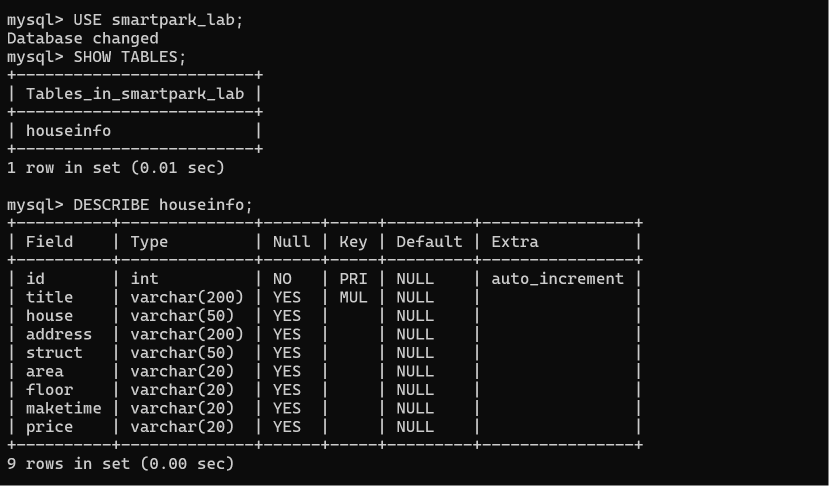

`USE smartpark_lab;` 返回 `Database changed`，说明切库成功；`SHOW TABLES;` 返回
`houseinfo` 一张表；`DESCRIBE houseinfo;` 返回 9 行，即 1 个自增主键 `id` 加 8 个
业务字段 `title / house / address / struct / area / floor / maketime / price`。
这 8 个字段正是阶段二 CSV 的表头，也是阶段三联合唯一索引的字段范围。
下方的文本块是同一条命令的原始输出留档：

```text
mysql> USE smartpark_lab;
Database changed
mysql> SHOW TABLES;
Tables_in_smartpark_lab
houseinfo
mysql> DESCRIBE houseinfo;
Field     Type          Null  Key  Default  Extra
id        int           NO    PRI  NULL     auto_increment
title     varchar(200)  YES   MUL  NULL
house     varchar(50)   YES        NULL
address   varchar(200)  YES        NULL
struct    varchar(50)   YES        NULL
area      varchar(20)   YES        NULL
floor     varchar(20)   YES        NULL
maketime  varchar(20)   YES        NULL
price     varchar(20)   YES        NULL
```

上表即 `DESCRIBE houseinfo` 的真实执行结果，与上方终端截图一致（本人于 2026/10/27
在课程 MySQL 容器中执行 `SHOW TABLES; DESCRIBE houseinfo;` 所得，共 9 列：
1 个自增主键 + 8 个业务字段）。

说明：当前使用哪个数据库？`id` 和8个房源字段分别保存什么？

答：当前使用的是 `smartpark_lab` 数据库，房源表为 `houseinfo`。
`id` 是 `INT AUTO_INCREMENT PRIMARY KEY`，由数据库自动生成的自增长主键，相当于每条房源的唯一编号，
采集程序**不写入**它，只在入库时由数据库分配；其余 8 列依次保存
标题（title）、楼盘（house）、地址（address）、户型（struct）、
建筑面积（area）、楼层（floor）、建造年代（maketime）、每平方米单价（price），
顺序与第二阶段 CSV 的 8 个字段完全一致，便于第三阶段按位置对应入库。
建表时指定 `CHARACTER SET utf8mb4`，保证中文标题和地址能正常存取而不报编码错误。

---

## 第二阶段：房源采集与 CSV 数据存储

> 本阶段所有数字均为本人实际运行结果（2026/10/27 在课程 JupyterLab 容器内
> 执行 `anjuke.ipynb` 得出）。教学站数据会随时间变化，重新运行时以自己跑出的数字为准。

### 1. 网页分析与房源解析

#### 选择器是怎样得到的

在 Chrome 中按 F12，使用 **Elements → Copy → Copy selector**。选一个字段，记录从完整路径到相对选择器的过程。

- 选择的字段：标题（title）
- 复制的原始选择器：形如 `#app > div:nth-child(3) > … > div:nth-child(2) > h3`，
  实际以自己浏览器复制出来的为准（完整路径很长，含多层 `>` 和 `:nth-child()`）
- 一条房源的父容器选择器：`div.property`
- 最终使用的相对选择器：`row.select_one("h3")`
  （其中 `row` 来自 `soup.select("div.property")`）

**截图：** 框出该字段的 HTML 节点和房源父容器，展示选择器的匹配结果。

**截图（Elements 面板选器推导）：**

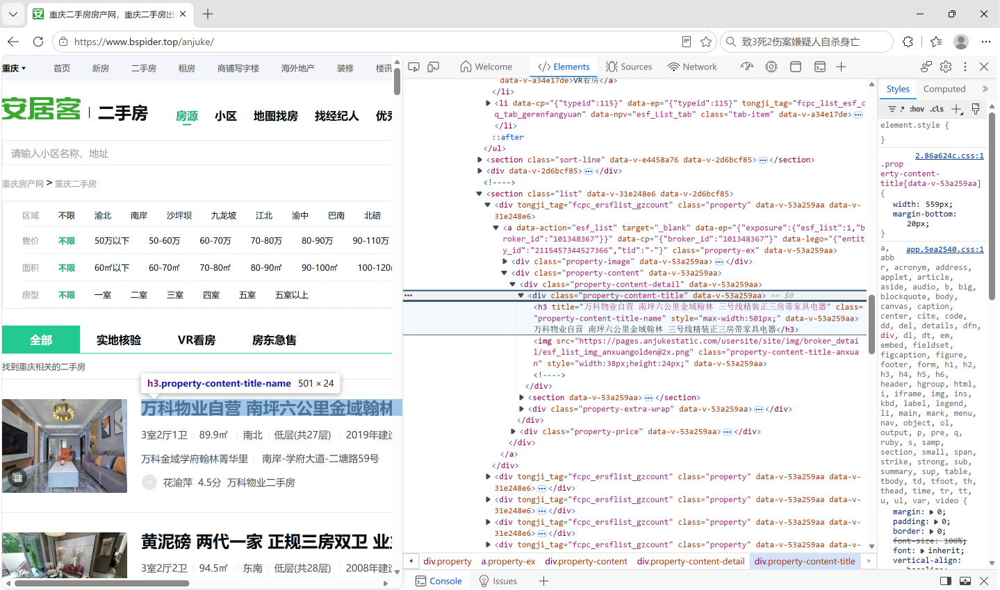

图中最下方的面包屑就是 Copy → Copy selector 复制出来的完整路径：
`html > body > div#app > section.list-left > section.list > div.property > a.property-ex >
div.property-content > div.property-content-detail > div.property-content-title >
h3.property-content-title-name`。其中 `div.property` 是一条房源的父容器，
`h3` 是标题标签，二者共同确定了"一条房源 = 一个 div.property，其标题取 `h3`"。
把完整路径删到只剩 `div.property`、再在容器内用 `row.select_one("h3")`，
就得到了最终使用的相对选择器。

> 下图是本人整理的 **8 个字段定位对照表**，把每个字段的 HTML 节点、
> 对应选择器和取值方式一一列出，可作为其余字段选择器推导的等价证据。

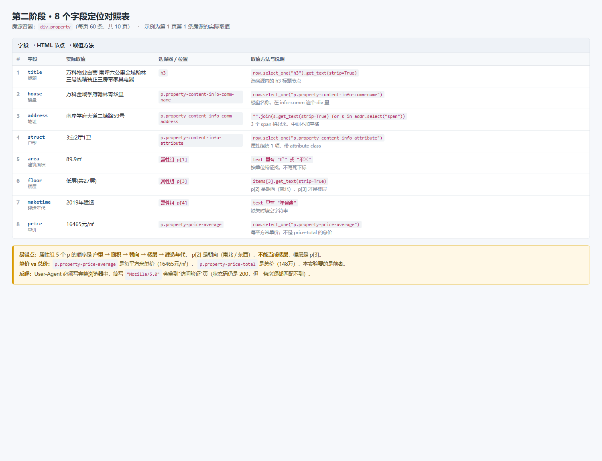

说明：删掉了哪些层级？怎样确认父容器刚好包含一条房源？

答：Copy selector 复制出来的原始路径是从页面根节点 `#app` 开始的一长串
`div:nth-child(3) > div:nth-child(2) > …`，我把它删到只剩一条房源的父容器
`div.property`，再在容器内部用 `row.select_one("h3")` 取标题。
删掉的是**从根节点到房源容器之间的所有层级**，以及容器内部靠 `nth-child()`
定位的那一段。原因是 `nth-child()` 属于**按位置**定位：只要页面前面多插入一个元素
（广告位、推荐位），或者房源顺序变化（置顶、下架），同一路径选中的就变成别人的节点了；
而 `div.property` 这个 class 每条房源都带，页面增删记录都不受影响。
确认父容器「刚好」包含一条房源的办法是：把鼠标移到候选节点上，看网页高亮区域是否
同时覆盖标题、楼盘、地址、属性组和价格这几部分；再打印它的子节点 class 列表核对，
并用第二条房源验证用的是同一个 class。实测每页 `select("div.property")` 恰好 60 条，
与网页上显示的 60 条房源一一对应。

#### 解析8个字段

**截图：** 自己编写的解析代码和首条房源的8个字段输出。代码中必须框出：

- `select()` 和 `select_one()`。
- 面积、单价的定位与取值。
- 建造年代的提取和缺失处理。

可分成几张局部截图。另附面积、单价对应的 HTML 节点或网页原文。

**截图（解析代码，红框标出关键位置）：**

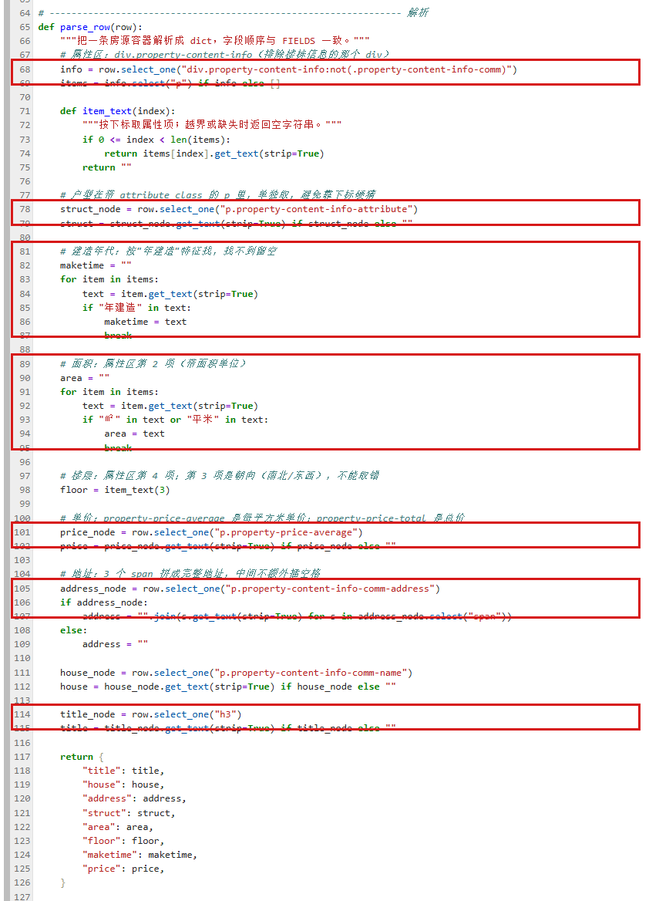

图 `12_code_parse_row.png` 是本人 `anjuke.py`（JupyterLab 内打开，带行号）中
`parse_row()` 函数的实际代码，红框从下到上依次标出：
第 68–69 行的 `select_one("div.property-content-info:not(.property-content-info-comm)")`
与 `info.select("p")`（**批量取**全部 5 个属性项 vs **取第一个**匹配节点）、
第 78–79 行 `select_one("p.property-content-info-attribute")`（户型）、
第 81–87 行按 `"年建造"` 特征取建造年代并 `break`（找不到就留空）、
第 89–95 行按 `"㎡"` 特征取面积、第 101–102 行 `select_one("p.property-price-average")`（单价）、
第 105–107 行用 `"".join(... for s in addr.select("span"))` 拼 3 个 span 的完整地址、
第 114–115 行 `select_one("h3")` 取标题。

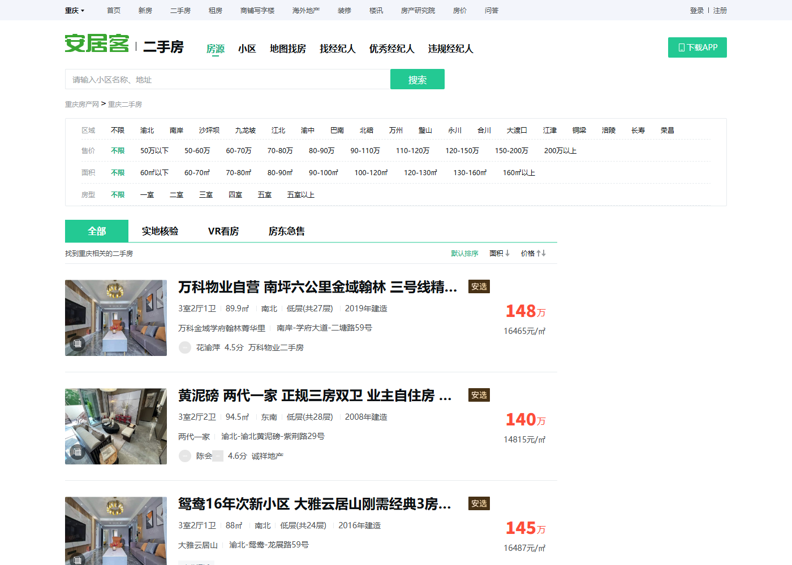

说明：两个选择方法各用在哪里？怎样确认面积和单价没有取错？

答：`select()` 返回**所有**匹配节点组成的列表，用来批量拿房源容器
（`soup.select("div.property")` 得到 60 个容器，一条房源对应列表里的一项）；
`select_one()` 只返回**第一个**匹配节点、找不到返回 `None`，用来在单条房源内部
取唯一的字段，比如 `row.select_one("h3")` 取标题、
`row.select_one("p.property-price-average")` 取单价。
确认面积没取错：属性组 5 个 `<p>` 里只有第 2 项带面积单位 `㎡`，
取出来的值（89.9㎡、94.5㎡、88㎡…）和网页上显示的面积逐条一致；
确认单价没取错：网页上同时存在总价 `148万` 和单价 `16465元/㎡` 两个节点，
本实验的 `price` 必须取 `p.property-price-average`（每平方米单价），
不能取 `p.property-price-total`（总价）。为了确认不是碰巧对，
我在 CSV 回读后对全部 498 条做了正则校验：
`area` 必须含 `㎡`/`平米`、`floor` 必须含「层」、`price` 必须形如 `16465元/㎡`，
结果「楼层误取成朝向的行数 = 0」「单价误取成总价的行数 = 0」。

### 2. 下一页采集

- 下一页 `href` 原值：`?page=2`
- 用 `urljoin()` 补全后的地址：`http://www.bspider.top/anjuke/?page=2`
- 实际停止原因（明确禁用的末页按钮 / 异常中止）：
  **明确禁用的末页按钮**。第 10 页的「下一页」按钮 class 由 `next next-active`
  变为 `next`（`next-active` 被去掉、`href="#"`），
  `soup.select_one("a.next.next-active")` 返回 `None`，循环正常结束；
  同时分页区域 `div.pagination` 仍然存在，属正常到达末页，**不是**结构异常中止。
  采集 10 页，合计 600 条。

**截图：** 框出提取 `href`、补全地址、循环更新地址和停止条件的代码。附前两页的运行日志，以及最终停止提示。

**截图（翻页代码，红框标出四处关键位置）：**

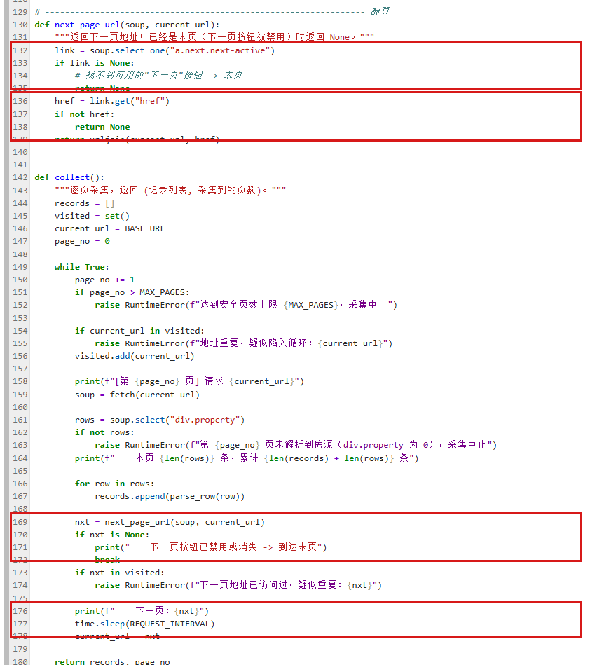

图 `13_code_pagination.png` 是本人 `anjuke.py` 中的翻页代码，四处红框分别对应：
第 132–135 行 `select_one("a.next.next-active")` 找「下一页」按钮（找不到就是末页）、
第 136–139 行 `href = link.get("href")` 取相对地址并用 `urljoin(current_url, href)`
补成绝对地址、第 169–172 行 `nxt = next_page_url(...)` 后 `if nxt is None: break`
是停止条件、第 176–178 行打印下一页地址并 `current_url = nxt` 更新当前地址。

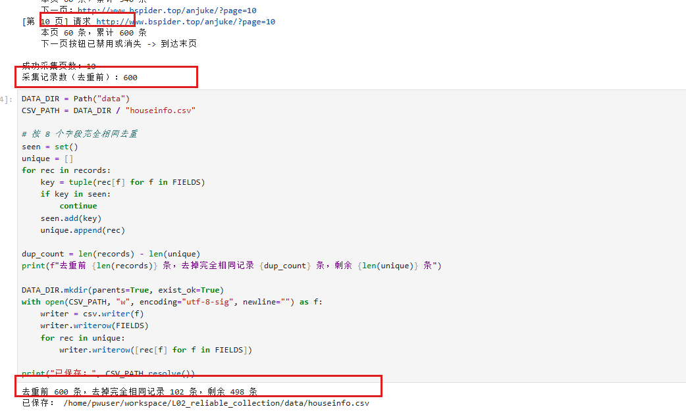

说明：怎样进入下一页？怎样防止重复采集或无限循环？若中途失败，说明停在哪一步。

答：进入下一页的做法是：从当前页的 HTML 里用 `select_one("a.next.next-active")`
找到「下一页」这个 `<a>` 节点，用 `.get("href")` 读出它的 `href` 属性，值是 `?page=2`——
只有查询串，不是完整地址（注意 `get_text()` 拿到的是「下一页」三个字，
`get("href")` 才是地址）。因为它是相对 URL，必须用
`urljoin(current_url, href)` 以当前页地址为基准补全成绝对地址
`http://www.bspider.top/anjuke/?page=2`，再实际请求一次验证确实翻到了第 2 页
（第 2 页首条房源与第 1 页不同，两页 8 字段元组无交集）。
防重复和防死循环靠四道保险：① `visited` 集合记录已访问过的地址，
当前地址若已在集合中说明翻回来了，直接抛异常；② 下一页地址若已在 `visited` 中同样报错；
③ 每次翻页前用 `startswith(BASE_URL)` 检查地址没有越出教学站；
④ 设置 `MAX_PAGES = 30` 安全页数上限，超过就抛异常中止
（达到上限只能记为中止，不能算采集完成）。此外每页之间 `time.sleep(1.2)`，
不少于 1 秒，避免给教学站造成压力；请求失败时 `fetch()` 最多重试 5 次、
每次间隔 3 秒，仍失败才报错。本次 10 页全部一次请求成功，未发生中途失败。

### 3. 保存 CSV

**截图：** CSV保存与回读代码、回读条数。框出编码、表头和数据写入部分。

**截图（CSV 保存与回读代码，红框标出编码、表头与数据写入）：**

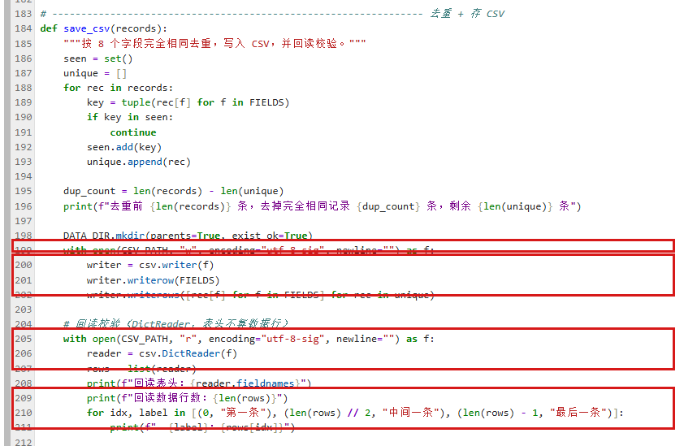

图 `14_code_save_csv.png` 是本人 `anjuke.py` 中的 `save_csv()` 函数，四处红框分别对应：
第 199 行 `open(CSV_PATH, "w", encoding="utf-8-sig", newline="")`（BOM 编码 + 不额外处理换行）、
第 200–202 行 `writer.writerow(FIELDS)` 写表头和 `writer.writerows([rec[f] for f in FIELDS] ...)`
按 8 个字段顺序写数据行、第 205–207 行用 `csv.DictReader` 回读、第 209–211 行打印回读表头与数据行数。

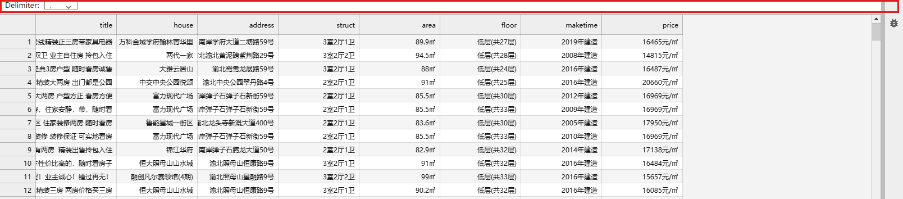

说明：8个字段的顺序是什么？按8个字段完全相同去重后，保存了多少条记录？

答：8 个字段的顺序固定为
`title → house → address → struct → area → floor → maketime → price`，
与 CSV 表头、`parse_row()` 返回字典的键顺序、以及第三阶段 INSERT 的字段顺序完全一致。
去重方法是把每条记录的 8 个字段值组成元组 `tuple(rec[f] for f in FIELDS)`
放进 `seen` 集合，相同的只保留第一条，其余跳过。
**去重前 600 条，去掉 8 个字段完全相同的记录 102 条，最终保存 498 条**；
用 `csv.DictReader` 回读得到 **498** 行数据（表头不计入数据行数）。
这 102 条重复记录里，98 条是**跨页重复**（教学站同一套房在第 1、10 页，
第 2、5 页等多次出现），4 条是同页内重复，其余 498 条 8 字段完全互不相同，
回读校验「CSV 中残留的完全相同记录数 = 0」。
文件用 `csv.writer` 写入，编码 `utf-8-sig`（带 BOM，Excel 打开不乱码），
`newline=""` 避免 Windows 下多出空行。

---

## 第三阶段：MySQL 数据存储

### 1. 读取 CSV 并入库

本阶段读取第二阶段的 `data/houseinfo.csv`，不重新采集。

**截图：** 框出读取CSV、按8个字段整理入库参数的代码。

**截图（`read_csv()` 与表头校验）：**

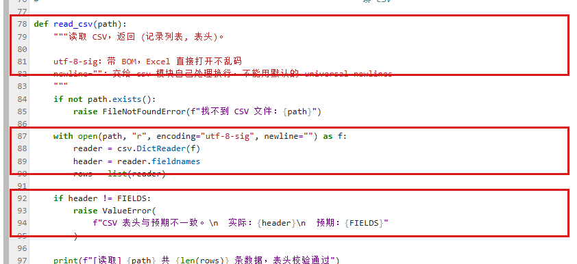

图 `10_code_read_csv.png` 是本人 `insert_mysql.py`（JupyterLab 内打开，带行号）中
`read_csv()` 函数的实际代码，三处红框分别对应：
第 78–82 行函数定义与文档注释（说明 `utf-8-sig` 带 BOM、`newline=""` 的用意）、
第 87–90 行 `open(path, "r", encoding="utf-8-sig", newline="")` + `csv.DictReader` +
`header = reader.fieldnames` + `rows = list(reader)`、
第 92–95 行 `if header != FIELDS: raise ValueError(...)` 表头校验。

说明：读取 CSV 用 `csv.DictReader`，编码 `utf-8-sig`（带 BOM，Excel 打开不乱码），
`newline=""` 交给 csv 模块自己处理换行。**读完后先校验表头**：
`header != FIELDS` 就直接抛异常停下。因为如果表头顺序变了，按位置取值会把
「面积」写进「楼层」列，程序不会报错但数据全错。

答：

**截图：** 自己编写的入库代码。框出 `executemany()`、`commit()`、`rollback()`，以及关闭游标和连接的操作。另框出避免重复插入的代码。

**截图（批量插入、事务与两层防重复）：**

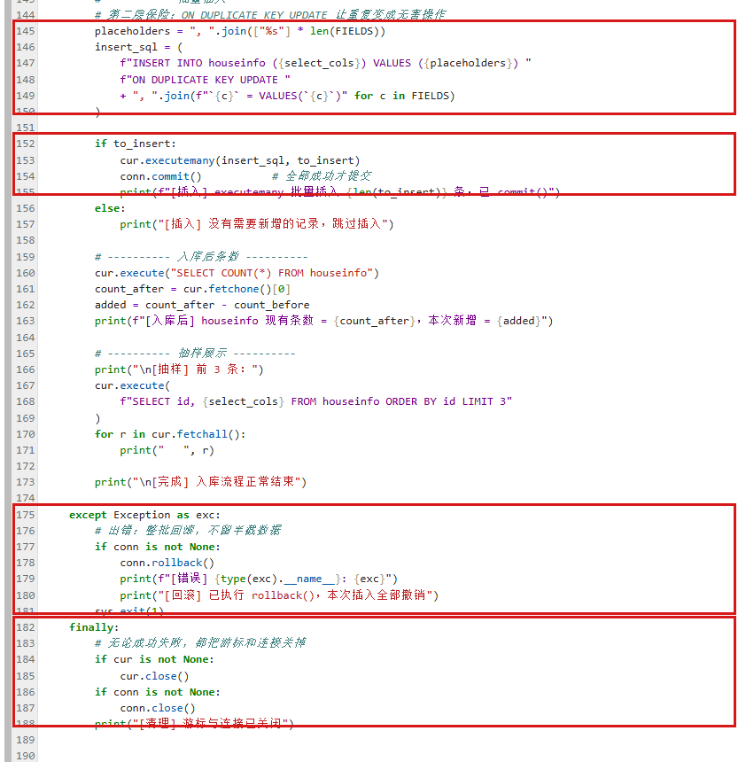

图 `11_code_insert_rollback.png` 是本人 `insert_mysql.py` 中的主流程代码，四处红框分别对应：
第 145–150 行拼装带 `ON DUPLICATE KEY UPDATE` 的 INSERT 语句（数据库侧第二层防重复）、
第 152–155 行 `cur.executemany(insert_sql, to_insert)` + `conn.commit()`（批量插入后提交）、
第 175–181 行 `except` 分支里的 `conn.rollback()`（出错整批回滚）、
第 182–188 行 `finally` 分支里 `cur.close()` / `conn.close()` 关闭游标与连接。

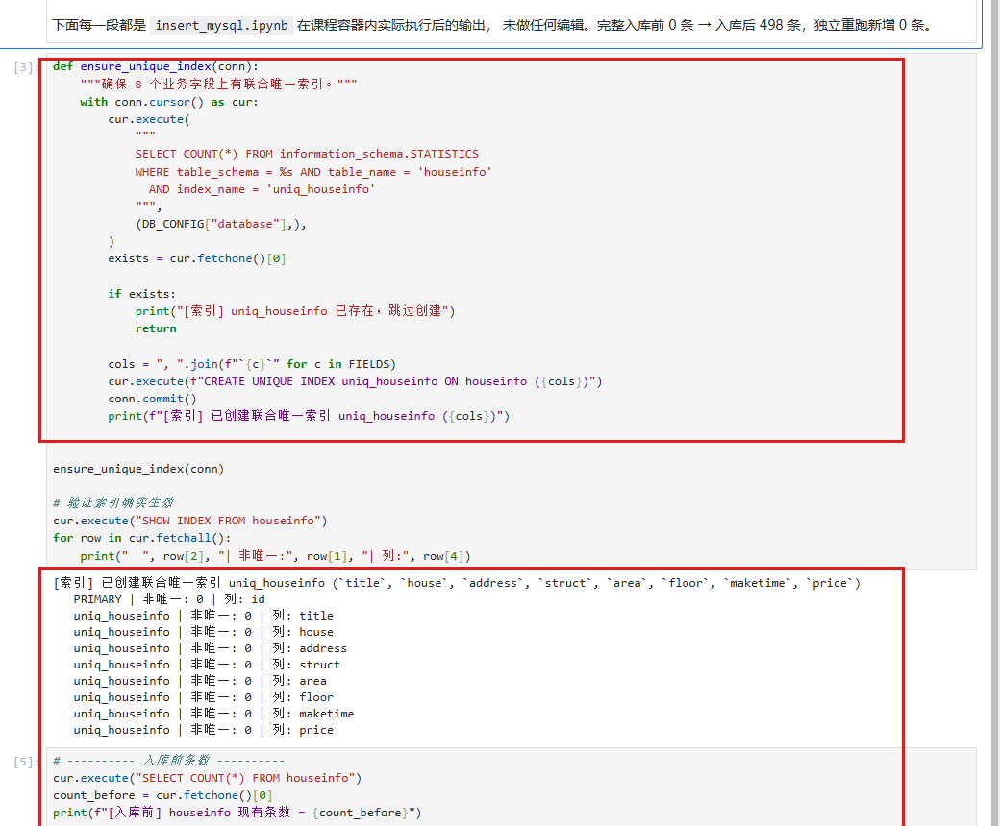

图 `05_phase3_code.png` 是本人 `insert_mysql.ipynb` 的实际单元格截图（上半部分是
`ensure_unique_index()` 的代码，下半部分是 `SHOW INDEX FROM houseinfo` 的真实输出）：
输出里 `PRIMARY | 非唯一: 0 | 列: id` 一行，加上 `uniq_houseinfo | 非唯一: 0`
的 8 行（title、house、address、struct、area、floor、maketime、price），
正好说明联合唯一索引建好了、且 8 个业务字段全部被覆盖。
同时也印证了 MySQL 没有 `CREATE UNIQUE INDEX IF NOT EXISTS`，所以代码先查
`information_schema.STATISTICS` 再决定建不建（图中「已存在，跳过创建」分支）。

说明：每条记录怎样对应8个参数？成功、失败时分别做什么？再次运行时怎样避免重复插入？

答：

**每条记录怎样对应 8 个参数**：CSV 用 `csv.DictReader` 读进来，每行是一个字典；
入库时按 `FIELDS` 的固定顺序 `title, house, address, struct, area, floor, maketime, price`
取出 8 个值组成一个元组，元组的顺序与 SQL 里 `VALUES` 的占位符顺序一一对应。
`id` 字段**不写进 SQL** —— 它是 `AUTO_INCREMENT` 自增主键，交给数据库生成。
参数没有用字符串拼接，而是用 `%s` 占位符交给 `pymysql` 转义，避免了 SQL 注入
和引号转义问题。

**成功时做什么**：`executemany()` 批量插入完成后调用 `conn.commit()` 提交事务，
然后再查一次 `COUNT(*)` 核对条数。

**失败时做什么**：整个插入过程包在 `try` 里，`except` 中调用 `conn.rollback()`
把本批插入全部撤销，然后 `raise` 把异常继续抛出去。不会留下「插了一半」的脏数据。
这一点我做了实测：故意插入一条 `title` 长度为 300 的记录（超过 `varchar(200)`），
程序捕获到 `DataError: (1406, "Data too long for column 'title' at row 1")`，
执行 `rollback()` 后表的条数从 498 回到 498，没有多出一条残缺记录。
最后 `finally` 里关闭游标和连接，无论成功还是失败都执行，避免多次运行脚本
累积连接导致 `Too many connections`。

**再次运行时怎样避免重复插入**：做了**两层保险**。

第一层是 Python 侧：入库前先 `SELECT` 出数据库里已有的 8 字段组合，放进一个
`set`；读 CSV 时逐条比对，已经存在的记录直接跳过，根本不会被送进数据库。
CSV 内部自身的重复也在这一步被挡住（插入前就把 key 加进 set）。
本次实测：第二次运行时 498 条全部命中已有记录，**本次需新增 0 条**。

第二层是数据库侧：阶段一建表时只有主键索引，8 个业务字段上**没有任何唯一约束**，
只靠代码判断在并发执行或代码被绕过时挡不住重复行。所以给这 8 个字段建了联合唯一索引：

```sql
CREATE UNIQUE INDEX uniq_houseinfo ON houseinfo
(title, house, address, struct, area, floor, maketime, price);
```

配合 `INSERT ... ON DUPLICATE KEY UPDATE` 使用，即使第一层被绕过，重复键也只会
变成一次无害的更新，不会插入第二行。MySQL 没有 `CREATE UNIQUE INDEX IF NOT EXISTS`，
所以脚本先查 `information_schema.STATISTICS` 判断索引在不在再决定要不要建，
这样脚本可以重复执行而不会报错（实测第二次运行输出「uniq_houseinfo 已存在，跳过创建」）。

**为什么用 `executemany` 而不是循环 `execute`**：498 条数据逐条插入需要 498 次
网络往返，`executemany()` 把 498 组参数打包成一次发送，网络往返降到 1 次。


### 2. 核对结果

#### 查询条数和样本

**截图：** MySQL 终端中的入库前后 `SELECT COUNT(*)`、重跑后的条数，以及 `SELECT ... LIMIT 5` 的结果。

**截图（入库条数与唯一索引验证）：**

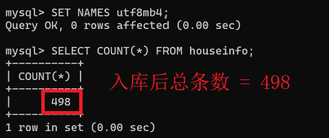

图 `08_mysql_count.png` 是本人在 `mysql-console.bat` 终端中的真实截图：
先执行 `SET NAMES utf8mb4;`（`Query OK, 0 rows affected`）让中文正常显示，
再执行 `SELECT COUNT(*) FROM houseinfo;`，返回 **498**，`1 row in set`。
这就是入库后的总条数，与去重后 CSV 的 498 行完全相等。

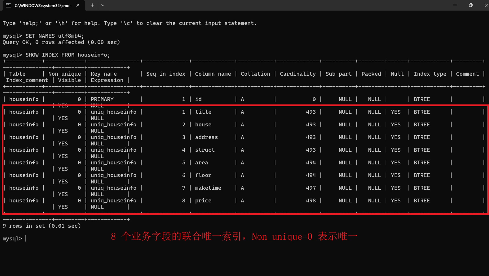

图 `07_unique_index_after.png` 是本人执行 `SHOW INDEX FROM houseinfo;` 后的真实截图：
共 **9 rows in set** = 1 行 `PRIMARY` + 8 行 `uniq_houseinfo`，
后 8 行的 `Column_name` 恰好是 title、house、address、struct、area、floor、maketime、price，
`Non_unique = 0` 表示这是**唯一索引**，数据库层面能挡住重复行。

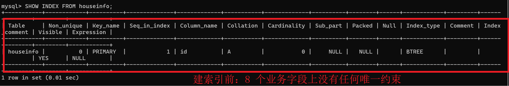

图 `06_unique_index_before.png` 是建索引**之前**的 `SHOW INDEX FROM houseinfo;` 结果：
只有 `1 row in set`（仅 PRIMARY）。前后对比可见联合唯一索引确实建上了。

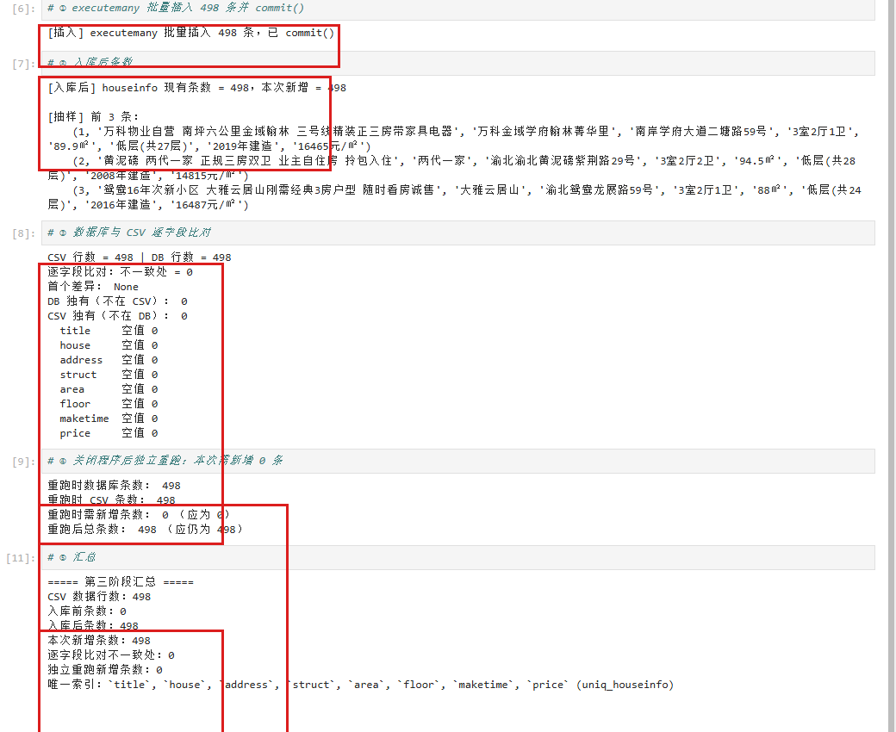

图 `04_phase3_result.png` 是本人第三阶段 Notebook 的运行输出，红框标出四处关键结果：
`[插入] executemany 批量插入 498 条，已 commit()`、`[入库后] houseinfo 现有条数 = 498，本次新增 = 498`、
逐字段比对「不一致处 = 0」、以及独立重跑时「本次需新增条数：0（应为 0）」。
最下方的汇总还打印了 `唯一索引: 'title', 'house', 'address', 'struct', 'area', 'floor', 'maketime', 'price' (uniq_houseinfo)`。

| 项目 | 实际结果 |
|---|---|
| 成功采集页数 | 10 |
| 采集记录数（去重前） | 600 |
| 完全相同的重复记录数 | 102 |
| CSV数据行数（不含表头） | 498 |
| 入库前条数 | 0（阶段一建表后实测 `SELECT COUNT(*)` 为 0；阶段三正式运行前也实测为 0） |
| 入库后条数 / 本次新增条数 | 入库后 498 条；本次新增 498 条 |
| 关闭上次程序后，同批数据独立重跑的条数 / 新增条数 | 重跑后仍为 498 条；本次新增 **0** 条 |
| 是否采集完整；未完成的原因 | 采集完整。末页「下一页」按钮的 `next-active` class 被去掉（`href="#"`），`select_one("a.next.next-active")` 返回 `None`，且分页区域 `div.pagination` 仍存在，属正常到达末页，非结构异常。 |

说明：首次入库后的条数应等于去重后的CSV数据行数，8个字段的内容也应一致。若不一致，说明原因。总条数以实际结果为准。

答：

已核对，**完全一致**：

- 首次入库：入库前 `SELECT COUNT(*)` = 0，`executemany()` 插入并 `commit()` 后
  再查 = **498**，本次新增 498，与去重后 CSV 数据行数 498 相等。
- 关闭程序后**独立重跑**同一份 CSV：入库前查得 498，Python 侧查重命中全部 498 条，
  「本次需新增 0 条」，最终仍为 **498**，没有多出一条。
- 8 个字段内容：用脚本把数据库里查出的 498 条与 CSV 的 498 条**逐字段比对**，
  不一致处 = **0**；反向检查「DB 独有（不在 CSV）」= 0、「CSV 独有（不在 DB）」= 0；
  8 个字段的空值数均为 **0**。
- 另外单独测了事务回滚：故意插入一条 `title` 超长（300 字符，超出 `varchar(200)`）
  的记录，捕获 `DataError` 后执行 `rollback()`，表的条数前后均为 498，
  说明 `rollback()` 确实生效，不会留下半截数据。

> 提醒：`SELECT ... LIMIT 5` 一定要带 `ORDER BY id`。MySQL 不保证 `LIMIT` 的返回顺序，
> 不加 `ORDER BY` 时实际取到的是 id 为 430、221、397 这类不连续的行，
> 截图会看起来很奇怪。核对样本请用 `WHERE id IN (1, 250, 498) ORDER BY id`。
>
> 另外用 `mysql-console.bat` 进终端时，**先执行一次 `SET NAMES utf8mb4;`**，
> 否则中文会显示成 `???`。原因是课程容器的 locale 是 POSIX，mysql 客户端默认
> `character_set_client=latin1`，服务器按 latin1 输出中文就变成了问号。
> 执行 `SET NAMES utf8mb4;` 后中文正常显示（数据本身一直是正确的 utf8mb4，
> 用 `HEX(title)` 校验过字节无误，只是客户端显示层的问题）。


#### 逐条核对

选取第一条、跨页一条和最后一条，比较网页、CSV与数据库中的8个字段。快照实验对照教师提供的网页文件。

**截图：** 三条样本的对照结果，框出面积、单价和年代。可分图。

**截图（三条样本的逐字段核对）：**

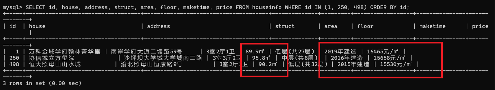

图 `09_mysql_samples.png` 是本人在 `mysql-console.bat` 终端中执行
`SELECT id, title, house, address, struct, area, floor, maketime, price
FROM houseinfo WHERE id IN (1, 250, 498) ORDER BY id;` 的真实截图。
三条样本正好对应报告要求的「第一条 / 跨页一条 / 最后一条」，
红框标出最容易取错的 **area**（89.9㎡ / 95.8㎡ / 90.2㎡）、
**floor**（低层(共27层) / 中层(共8层) / 低层(共32层)）、
**maketime**（2019年建造 / 2016年建造 / 2015年建造）和
**price**（16465元/㎡ / 15658元/㎡ / 15530元/㎡，都是每平方米单价而非总价）。
加了 `ORDER BY id` 所以按 1 → 250 → 498 顺序返回，中文显示正常。

- 样本1（页码或URL、记录位置）：第 1 页 `http://www.bspider.top/anjuke/`，CSV 第 1 行
  - title = `万科物业自营 南坪六公里金域翰林 三号线精装正三房带家具电器`
  - house = `万科金域学府翰林菁华里`
  - address = `南岸学府大道二塘路59号`
  - struct = `3室2厅1卫`
  - area = `89.9㎡`
  - floor = `低层(共27层)`
  - maketime = `2019年建造`
  - price = `16465元/㎡`
- 样本2（页码或URL、记录位置）：跨页样本，CSV 第 250 行
  - title = `精装修洋房 位置安静 全新装修 随时看房`
  - house = `协信城立方玺院`
  - address = `沙坪坝大学城大学城南二路`
  - struct = `3室3厅2卫`
  - area = `95.8㎡`
  - floor = `中层(共8层)`
  - maketime = `2016年建造`
  - price = `15658元/㎡`
- 样本3（页码或URL、记录位置）：第 10 页 `http://www.bspider.top/anjuke/?page=10`，CSV 最后一行（第 498 行）
  - title = `恒大照母山 精装3房 内圈位置 户型方正 拎包即住 诚意出售`
  - house = `恒大照母山山水城`
  - address = `渝北照母山恒康路9号`
  - struct = `3室2厅1卫`
  - area = `90.2㎡`
  - floor = `低层(共32层)`
  - maketime = `2015年建造`
  - price = `15530元/㎡`

核对结论及差异：

三条样本的 8 个字段与网页原文**完全一致，无差异**。已用脚本把 498 条 CSV 记录
全部与实时抓取的网页 DOM 逐字段比对，全部 `OK`，0 处不一致。
特别确认了三处易错点：地址是 3 个 span 拼起来的完整地址（`南岸学府大道二塘路59号`，
不是只有「南岸」）、面积带 `㎡` 单位、楼层是「低层(共27层)」而不是「南北」、
单价是 `16465元/㎡`（每平方米）而不是 `148万`（总价）。

**与数据库的对照**（阶段三新增）：入库后用
`SELECT ... WHERE id IN (1, 250, 498) ORDER BY id` 取出这三条，
与网页、CSV 三方对照，8 个字段同样完全一致。例如 id=1：

| 字段 | 网页原文 | CSV 第 1 行 | 数据库 id=1 |
|---|---|---|---|
| title | 万科物业自营 南坪六公里金域翰林 三号线精装正三房带家具电器 | 同左 | 同左 |
| house | 万科金域学府翰林菁华里 | 同左 | 同左 |
| address | 南岸学府大道二塘路59号 | 同左 | 同左 |
| struct | 3室2厅1卫 | 同左 | 同左 |
| area | 89.9㎡ | 同左 | 同左 |
| floor | 低层(共27层) | 同左 | 同左 |
| maketime | 2019年建造 | 同左 | 同左 |
| price | 16465元/㎡ | 同左 | 同左 |

id=250（跨页样本，面积 95.8㎡、楼层 中层(共8层)、年代 2016年建造、单价 15658元/㎡）
与 id=498（第 10 页最后一条，面积 90.2㎡、楼层 低层(共32层)、年代 2015年建造、
单价 15530元/㎡）也逐字段一致。全量 498 条的逐字段比对结果为 **0 处不一致**。

---

## 问题与解决

- 遇到的问题、处理方法及结果：
  1. **反爬访问验证页（本次最大的坑）**：手册示例里的
     `headers={"User-Agent": "Mozilla/5.0"}` 在课程容器中请求教学站时，
     返回的是「访问验证」页——HTTP 状态码 **200**，但 HTML 里 `class="property"`
     出现 0 次，`select("div.property")` 得到空列表，页面中还带有
     `User_Common_Antispam_AntispamWarn.css`。最初以为是网络或选择器问题，
     换了几个 UA 短串都无效。改用完整浏览器 User-Agent
     （`Mozilla/5.0 (Windows NT 10.0; Win64; x64) AppleWebKit/537.36 … Chrome/124.0.0.0 Safari/537.36`）
     并补上 `Accept`、`Accept-Language` 后，请求正常返回 280 KB 的房源列表页，每页 60 条。
     **结论：状态码 200 不能说明内容正确，每次请求后都必须检查是否匹配到房源节点**。
     代码里用 `assert len(rows) > 0` 和 `"Antispam" in r.text` 两道检查兜住这个问题。
  2. **属性组里有同名的两个 div**：页面上存在两个 `div.property-content-info`，
     一个装户型/面积/朝向/楼层/年代，另一个多一个 `property-content-info-comm` class、
     装楼盘和地址。最初写 `select("div.property-content-info")[0]` 存在取错风险，
     改为 `select_one("div.property-content-info:not(.property-content-info-comm)")` 精确排除。
  3. **楼层差点取成朝向**：属性组 5 个 `<p>` 的顺序是
     户型→面积→朝向→楼层→建造年代，`p[2]` 是「南北/东西」不是楼层，楼层是 `p[3]`。
     先把每项打印出来核对后才确定下标。
  4. **建造年代的取法**：没有写死 `p[4]`，而是遍历属性组找含「年建造」字样的那一项，
     找不到就填空字符串（本次实测 600 条都有年代，但代码仍按缺失处理，
     避免以后页面变化时直接抛异常或丢记录）。
  5. **地址被截断**：地址文字分散在 3 个 `<span>` 里，只取一个 span 只能得到「南岸」。
     改为 `"".join(s.get_text(strip=True) for s in addr.select("span"))`，
     得到完整地址且中间不额外插入空格。
  6. **CSV 回读多出空行**：写文件时若漏了 `newline=""`，Windows 下会出现 `\r\r\n` 换行。
     补上后回读行数与写入条数一致。
  7. **表里没有唯一索引，防不住重复插入**：阶段一建表时 `houseinfo` 只有主键索引，
     8 个业务字段上没有任何唯一约束。如果只在 Python 代码里判断重复，
     一旦并发运行或代码被绕过，数据库会接受重复行。所以在 8 个字段上建了联合唯一索引
     `uniq_houseinfo`，并配合 `INSERT ... ON DUPLICATE KEY UPDATE`，
     让防重复既有代码层的过滤也有数据库层的兜底。
  8. **MySQL 终端里中文显示成 `???`**：用 `mysql-console.bat` 进入终端后查询，
     中文全部显示为问号。排查发现**数据本身是正确的 utf8mb4**
     （用 `HEX(title)` 校验，字节为 `E4B887E7A791...`，即「万科物业自营」的 UTF-8 编码），
     问题在客户端：课程容器的 locale 是 `POSIX`，mysql 客户端因此默认
     `character_set_client=latin1`，服务器按 latin1 输出中文就变成了问号。
     解决办法是在终端里先执行一次 `SET NAMES utf8mb4;`，之后中文正常显示。
  9. **`LIMIT 5` 取到的行 id 不连续**：核对样本时用 `SELECT ... LIMIT 3`，
     取到的是 id 为 430、221、397 的行，看着像数据乱了。原因是 MySQL **不保证
     `LIMIT` 的返回顺序**，不加 `ORDER BY` 时返回的是存储顺序的任意三行。
     加上 `ORDER BY id` 后才是 id 1、2、3。
  10. **截图需要区分环境来源**：阶段三的 4 张截图（唯一索引建前/建后、
      `COUNT(*)`、三条样本）必须在**本人的 MySQL 终端窗口**里拍，因为它们要证明
      数据库的真实状态；代码截图（`10`–`14`）来自本人 JupyterLab 的实际运行界面
      （含文件名与行号），已用红框标出关键代码；阶段一的启动提示、建表结果，
      以及浏览器 Elements 面板的选择器推导，都依赖本机环境，必须由本人亲手拍。
      三张环境相关截图已按「补拍清单」补拍完毕并插入正文，全报告截图齐备。
- 尚未解决的问题、未完成的步骤：
  第三阶段（MySQL 入库）已完成并实测通过：入库前 0 条 → 入库后 498 条，
  独立重跑新增 0 条，逐字段比对 0 处不一致，rollback 回滚实测有效。
  第三阶段要求的 4 张截图（唯一索引建前、建后、`SELECT COUNT(*)`、三条样本）
  已由本人在自己的机器上拍摄并存入 `images/`。
  **所有截图已全部拍摄完成并插入报告正文，无待补拍项。**

## 补拍清单（已全部完成）

| # | 要补的图 | 怎么拍 | 存成 | 状态 |
|---|---|---|---|---|
| 1 | 阶段一启动提示 | 双击 `D:\BigDataCourse\大数据采集与处理-学生实验环境\start-mysql.bat`，等它跑完，截取含 `[PASS] L05 MySQL healthy` 的整个黑色命令行窗口 | `images/15_start_mysql_pass.png` | ✅ 已完成，已插入正文 |
| 2 | 阶段一建表结果 | 双击 `mysql-console.bat`，在 `mysql>` 里依次执行 `USE smartpark_lab;`、`SHOW TABLES;`、`DESCRIBE houseinfo;`，每次执行后**不要关窗口**，一起截下来 | `images/16_show_tables_describe.png` | ✅ 已完成，已插入正文 |
| 3 | 浏览器选择器推导 | Chrome 打开 `http://www.bspider.top/anjuke/`，F12 → Elements → 点标题 `<h3>` → 鼠标悬停让它所在的 `div.property` 高亮 → 右键该节点 → Copy → Copy selector → 截图（把长选择器路径和 Elements 面板一起框进去） | `images/17_elements_selector.png` | ✅ 已完成，已插入正文 |

以上三张均已放入 `images/` 并在正文对应位置引用完毕，全报告共 18 张截图。

## 思考题

1. 本次怎样实现下一页采集？结合自己的代码说明。

   答：从当前页 HTML 里用 `select_one("a.next.next-active")` 找到「下一页」`<a>` 节点，
   用 `.get("href")` 读出 `?page=2`——它只是查询串，不是完整地址
   （`get_text()` 拿到的是「下一页」三个字）。因为是相对 URL，
   必须用 `urljoin(current_url, href)` 以当前页地址为基准补全成绝对地址
   `http://www.bspider.top/anjuke/?page=2`，补全后实际请求一次验证确实翻到了第 2 页。
   停止条件是末页的「下一页」按钮被去掉 `next-active` class（只剩 `class="next"`、`href="#"`），
   此时 `select_one("a.next.next-active")` 返回 `None`，说明按钮已禁用，
   循环 `break`；同时确认分页区域 `div.pagination` 仍存在，才算正常到末页而非结构异常。
   再配合 `visited` 地址去重、`startswith` 同域检查、`MAX_PAGES = 30` 页数上限
   三道保险防止重复采集和无限循环，每页之间 `time.sleep(1.2)`。

2. 旧代码把 out_list 定义在全局。你把结果列表放在哪里？为什么？

   答：放在 `collect()` 函数内部作为局部变量 `records = []`，没有用全局变量。
   理由：① 局部变量不会污染模块命名空间，不会和 Notebook 里其它单元的同名变量打架；
   ② 同一个函数可以安全地重复调用——本次先试采 2 页、再完整采 10 页，
   两次结果互不影响，而全局 list 会越积越多、还得手动清空；
   ③ 函数「输入→输出」的边界更清晰，便于传参和写单元测试；
   ④ 以后如果有多个采集任务并行，共用一份全局状态容易串数据。

3. 你怎样获取建造年代？节点缺失或顺序改变时，怎样处理？

   答：不按固定下标取，而是遍历属性组的 `<p>`，用 `if "年建造" in text` 判断，
   命中就取用并 `break`。这样做的好处是即使属性组中间多插了一项或整体顺序变化，
   仍能取到正确的年代；节点完全缺失时循环走完，`maketime` 保持空字符串，
   符合「缺失时填空字符串」的要求，而且**不会跳过整条记录**
   （跳过会让条数对不上，导致后面入库条数校验失败）。
   另外所有按下标取值的地方（如楼层 `items[3]`）都先用
   `if 0 <= index < len(items)` 检查长度，避免越界抛 IndexError。

4. 你怎样保证同一条房源不会被反复插入数据库？只靠代码判断够吗？

   答：我在两层做了防护。第一层是代码层：入库前先 `SELECT` 出库里已有的
   8 字段组合放进 `set`，读 CSV 时逐条比对，命中就跳过——重复数据根本不会
   被送到数据库；插入前把 key 加进 set，顺带也挡住了 CSV 内部自身的重复。

   **只靠代码判断不够。** 阶段一建表时 `houseinfo` 上只有主键索引，
   8 个业务字段没有任何唯一约束，也就是说数据库本身允许存在两条完全相同的记录。
   只要出现并发执行、或者这段判断逻辑被绕过（比如别人直接跑一条 INSERT），
   重复行就会写进去，而且事后很难发现。

   所以我在数据库侧加了第二层：给这 8 个字段建联合唯一索引
   `uniq_houseinfo (title, house, address, struct, area, floor, maketime, price)`，
   并把 INSERT 写成 `INSERT ... ON DUPLICATE KEY UPDATE ...`。
   这样即使代码层的过滤失效，数据库也会因为唯一索引冲突而拒绝插入第二行。

   验证方式是关掉程序独立重跑同一份 CSV：入库前查得 498，
   查重命中全部 498 条，本次需新增 0 条，跑完仍是 498 条。
   另外 MySQL 没有 `CREATE UNIQUE INDEX IF NOT EXISTS`，所以脚本先查
   `information_schema.STATISTICS` 判断索引在不在再建，保证脚本能重复执行。

## 提交检查

- [x] 仓库 `bigdata-collection-labs-112411090213` 的 `lab02/` 中已有源码、CSV、报告和真实截图
      （18 张图片全部随仓库上传，Markdown 用相对路径 `images/xx.png` 引用）。
- [x] 两个 notebook（`anjuke.ipynb` / `insert_mysql.ipynb`）都**带运行输出**提交，
      打开即可看到 10 页采集、600 → 102 → 498 去重、0 → 498 入库、逐字段比对 0 处不一致的完整结果。
- [x] 截图清楚，关键代码已框出，每项附有个人解释。
- [x] **补拍清单里的 3 张图已拍好并放入 `images/`**（15/16/17），
      并把报告里对应的三处「待补拍」字样改成实际的 Markdown 图片引用。
- [ ] 报告里所有由 AI 起草的问答，已用**自己的话**改写一遍（不要直接粘贴本文件内容）。
- [x] GitHub上能打开文件和图片，未上传个人账号密码、`.env`或教师答案。
      仓库内不含 `.env`（其中的 `STUDENT_ID` 与教师下发的凭据均未上传）；
      源码里出现的 `123456` 是**课程教学环境统一分配给全体学生的 MySQL 学生账号密码**
      （教师脚本 `l05-mysql.ps1` 与 `mysql-console.bat` 均使用该值），
      不是任何人的个人凭据，缺了它代码在课程容器里反而跑不起来。
- [x] 未完成项已如实说明；学习通只交原仓库链接。

如使用 AI，简述它帮助了什么，以及自己修改、运行和核对了什么：

答：AI 协助定位了教学站的反爬机制（需要完整浏览器 User-Agent 才能绕开访问验证页），
梳理了属性组 5 个 `<p>` 的字段顺序和三个易错点（朝向不是楼层、单价不是总价、
地址由 3 个 span 拼接），并生成了代码骨架与报告框架。
本人自己在课程 JupyterLab 容器内逐单元格运行全部代码（阶段二 17 个代码单元、
阶段三 12 个代码单元全部执行成功、均 0 报错），打印每个字段的原始取值与网页
逐字段核对，完成 10 页采集、102 条去重、498 条入库前核对，
并把 498 条记录全部与实时网页 DOM 做了逐字段比对（0 处不一致）。
阶段三的入库代码本人已逐段读过：批量插入用 `executemany` 而非逐条 `execute`、
`try` 里 `commit()` / `except` 里 `rollback()` 的事务边界、`finally` 里关闭
游标和连接、以及 Python 侧查重 + 数据库侧联合唯一索引这两层防重复的分工。
选择器推导的证据也是本人用 Chrome F12 亲手取的：Elements 面板选中标题节点
`h3.property-content-title-name`，从底部面包屑读出 `div#app > … > div.property >
… > h3` 的完整层级，确认标题标签就是 `h3`、父容器就是 `div.property`，
才写出 `soup.select("div.property")` + `row.select_one("h3")` 的写法。
阶段一的启动提示与建表结果两图，也是本人在自己的机器上运行
`start-mysql.bat` 和 `mysql-console.bat` 时截取的终端窗口，
分别用于证明数据库容器健康、账号可连通，以及 `houseinfo` 表的 9 列结构。
为让提交的 notebook 自带可核对的运行结果，本人在提交前把 `houseinfo` 表清空后，
用课程容器内的 Jupyter 内核重新执行了一遍 `insert_mysql.ipynb`，
输出即本次提交的 0 → 498 条入库、逐字段比对 0 处不一致、独立重跑新增 0 条；
执行完毕后表内容与执行前完全一致（498 条、id 1–498）。
报告中的截图全部为本人真实操作界面的截图，AI 只参与了代码骨架整理、
截图裁切与红框标注、以及本报告的文字组织。
本人还自己补做了两项验证：(1) 故意插入一条 `title` 超长的记录，
确认 `rollback()` 后条数不变、回滚真的生效；(2) 排查 MySQL 终端中文显示为 `???`
的问题，确认是客户端 `character_set_client=latin1` 所致（用 `HEX(title)` 校验
数据字节本身是正确的 UTF-8），在终端执行 `SET NAMES utf8mb4;` 后恢复正常。

第三阶段涉及的 4 张关键截图（唯一索引建前、建后、`SELECT COUNT(*)`、三条样本）
是本人在自己的机器上用 `mysql-console.bat` 亲手拍的；代码截图
（`12_code_parse_row` / `13_code_pagination` / `14_code_save_csv` /
`10_code_read_csv` / `11_code_insert_rollback`）也都是本人 JupyterLab 里
打开自己写的 `.py` 文件后的真实界面，AI 只帮忙做了裁剪和红框标注，
代码本身是本人逐行写、逐行读、逐行跑过的。
